# SignalSift

SignalSift is a command-line tool for comparing Kismet wireless captures. Give it a baseline and a follow-up capture and it shows what changed: which devices are new, which have gone, and which are the most active.

It is built for network administrators, security professionals and technical surveillance countermeasures (TSCM) specialists who need to spot changes in a wireless environment. It ships as a single binary, opens no network ports and never modifies your captures.

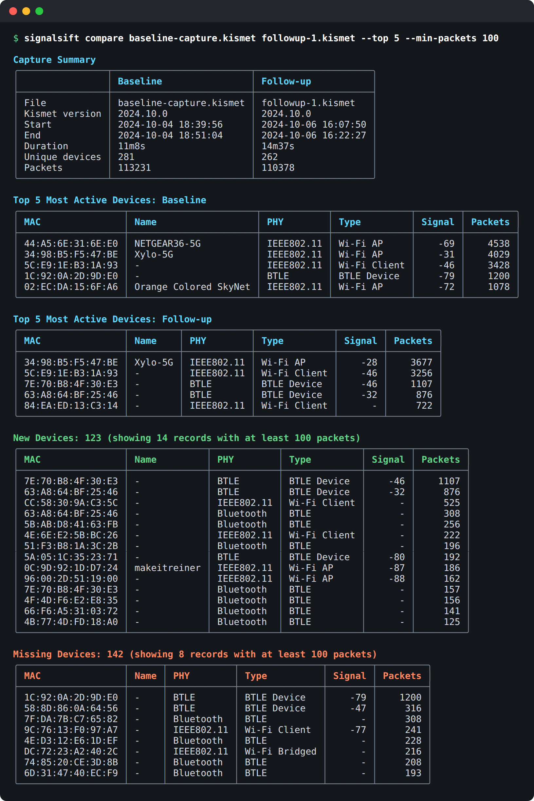

## Contents

- [Features](#features)
- [Installation](#installation)
- [Quick start](#quick-start)
- [Examples](#examples)
- [Commands](#commands)
- [Output formats](#output-formats)
- [HTML reports](#html-reports)
- [Scripting](#scripting)
- [How results are calculated](#how-results-are-calculated)
- [Reading the results](#reading-the-results)
- [Security](#security)
- [Common issues](#common-issues)
- [Development](#development)

## Features

- Compare a baseline Kismet capture to any follow-up capture
- Detect new and missing devices across Wi-Fi, Bluetooth and BTLE
- Show network and device names alongside MAC addresses
- Rank the most active devices in each capture
- Output tables, JSON or CSV, ready for pipes and scripts
- Write a self-contained HTML report to share or attach to a case file
- Read captures strictly read-only, including from read-only media
- Treat over-the-air names as untrusted input

## Installation

SignalSift needs [Go](https://go.dev/dl/) 1.27 or later to build. Once built, the binary has no dependencies. Kismet does not need to be installed, because SignalSift only reads the `.kismet` files it produces.

**Install with Go:**

```bash
go install github.com/Halcy0nic/SignalSift/cmd/signalsift@latest
```

**Or build from source:**

```bash
git clone https://github.com/Halcy0nic/SignalSift.git
cd SignalSift
go build -o signalsift ./cmd/signalsift
```

SignalSift is pure Go, so it cross-compiles without a C toolchain. For example, to build for a Raspberry Pi:

```bash
GOOS=linux GOARCH=arm64 go build -o signalsift ./cmd/signalsift
```

## Quick start

```bash
signalsift compare baseline.kismet followup.kismet
```

Run `signalsift --help` to see everything available:

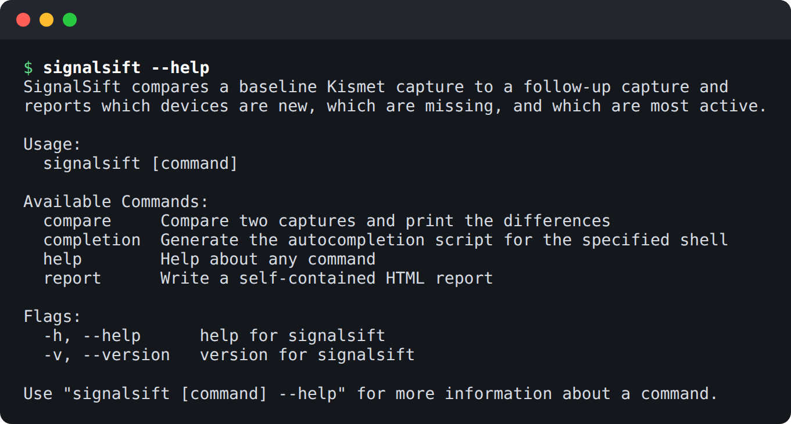

## Examples

Replace the file names with your own captures. The `jq` examples need [`jq`](https://jqlang.github.io/jq/) installed.

### Compare captures

```bash
# Full report
signalsift compare baseline.kismet followup.kismet

# Shorter top lists, hiding low-traffic devices
signalsift compare baseline.kismet followup.kismet --top 5 --min-packets 100

# Only the new and missing devices
signalsift compare baseline.kismet followup.kismet --top 0

# Two follow-ups against each other
signalsift compare followup-1.kismet followup-2.kismet --top 3

# Page through a long report, keeping the colours
CLICOLOR_FORCE=1 signalsift compare baseline.kismet followup.kismet | less -R
```

### Query the results

```bash
# Just the totals
signalsift compare baseline.kismet followup.kismet -f json \
  | jq '{new_total, missing_total}'

# New Wi-Fi networks by name
signalsift compare baseline.kismet followup.kismet -f json \
  | jq -r '.new[] | select(.type == "Wi-Fi AP" and .name != "") | [.mac, .name, .packets] | @tsv'

# Open (unencrypted) networks that disappeared
signalsift compare baseline.kismet followup.kismet -f json \
  | jq -r '.missing[] | select(.encryption == "Open") | [.mac, .name] | @tsv'

# New devices per type
signalsift compare baseline.kismet followup.kismet -f json \
  | jq '[.new[].type] | group_by(.) | map({type: .[0], count: length})'
```

### Save the results

```bash
# CSV file
signalsift compare baseline.kismet followup.kismet -f csv > devices.csv

# HTML report only
signalsift report baseline.kismet followup.kismet --min-packets 50 -o report.html

# Terminal output and an HTML report in one run
signalsift compare baseline.kismet followup.kismet --top 5 --html report.html
```

### Record a new capture and compare it

Kismet can record a follow-up to compare against an existing baseline. Running it without root requires membership of the `kismet` group. Replace `wlan0` with your interface, which `ip link` will show. The interface drops off its network while Kismet is using it.

```bash
# Record for a few minutes, then stop with Ctrl+C
mkdir -p captures
kismet -c wlan0 --log-prefix captures/

# Compare the new capture to your baseline
signalsift compare baseline.kismet captures/Kismet-*.kismet --top 5
```

The wildcard must match exactly one file, because `compare` takes two captures. Compare captures from the same location, or nearly every device will show as new or missing.

## Commands

### `signalsift compare`

Compares two captures and prints the differences.

```
signalsift compare <baseline.kismet> <followup.kismet> [flags]
```

| Flag | Default | Description |
| --- | --- | --- |
| `-f`, `--format` | `table` | Output format: `table`, `json` or `csv` |
| `--top` | `10` | Most active devices to list per capture. `0` hides these lists |
| `--min-packets` | `0` | Leave out devices with fewer packets than this |
| `--html` | | Also write an HTML report to this path |

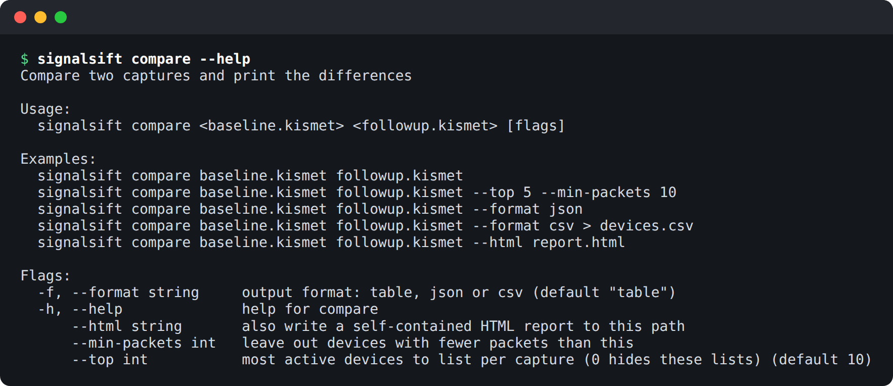

#### Most active devices

Use `--top` to choose how many devices to list for each capture.

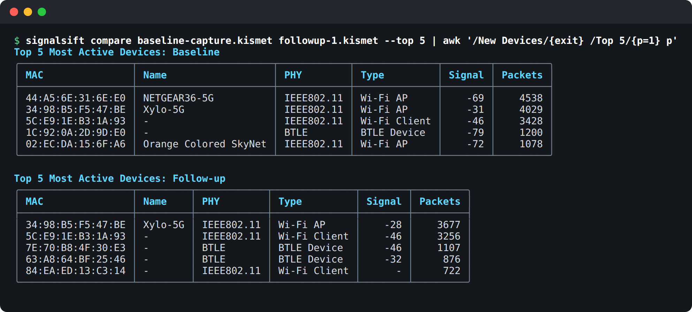

#### New and missing devices

Use `--top 0` to skip straight to the differences. `--min-packets` removes low-traffic devices, which are often passers-by. It only shortens the lists: the totals in the headings always count every device, so you can see how much was filtered out.

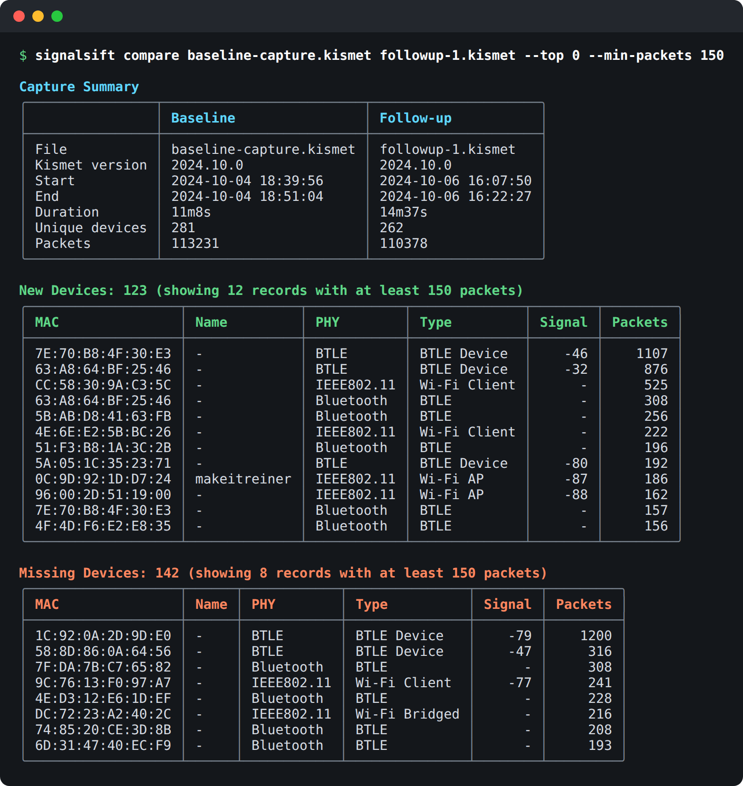

Compare the same baseline to a later capture to track an environment over time:

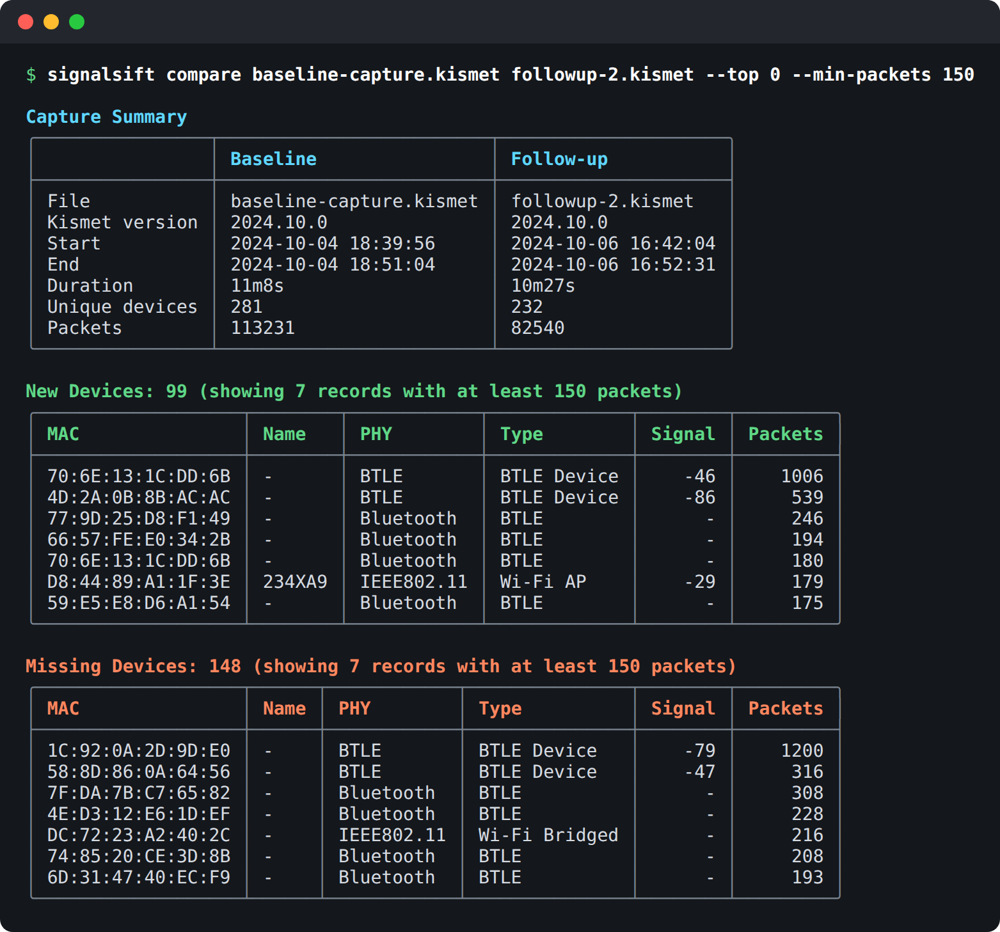

Any two captures can be compared, so you can also check two follow-ups against each other:

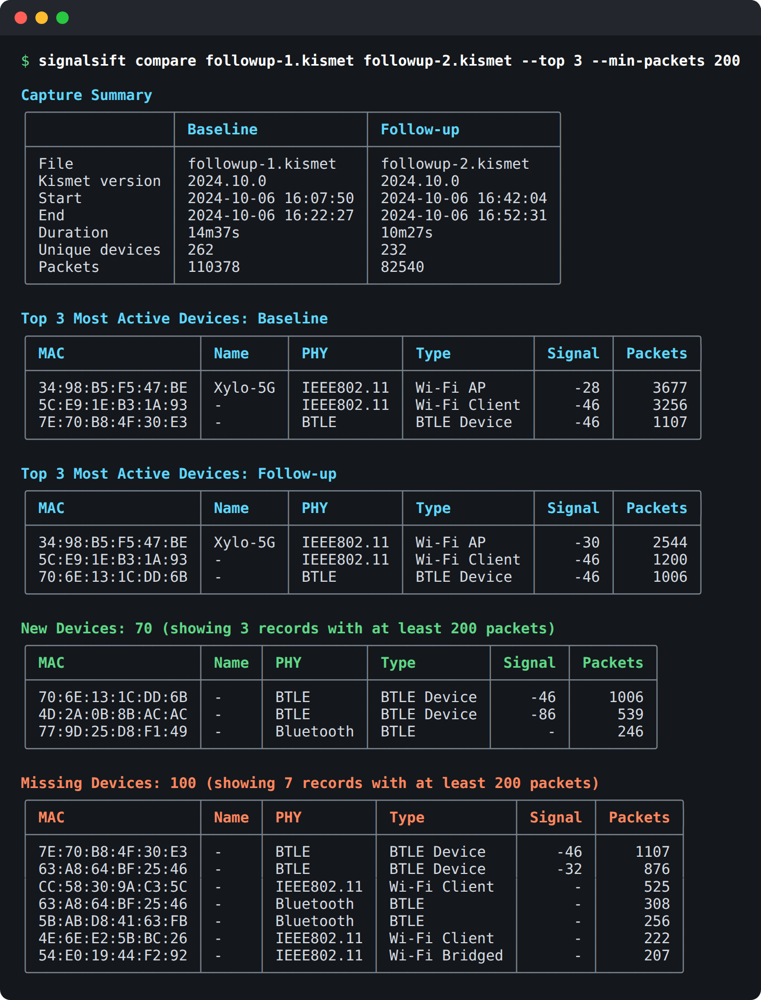

### `signalsift report`

Writes a self-contained HTML report. It accepts `--top` and `--min-packets`, and `-o`/`--output` sets the file path (default `report.html`).

```
signalsift report <baseline.kismet> <followup.kismet> -o report.html
```

### `signalsift completion`

Generates shell completion scripts for bash, zsh, fish and PowerShell. Run `signalsift completion --help` for setup steps.

## Output formats

### Table

The default. Colour is used only when writing to a terminal, so piped output stays clean. Set `NO_COLOR=1` to turn it off entirely.

### JSON

`--format json` includes the capture summaries and every listed device, with fields the table leaves out, such as manufacturer, channel, encryption and first/last seen times.

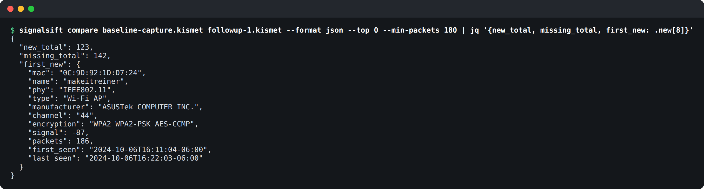

| Field | Description |
| --- | --- |
| `baseline`, `followup` | Capture summaries |
| `new_total`, `missing_total` | Distinct MACs, before `--min-packets` applies |
| `new`, `missing` | Device records, busiest first |
| `top_baseline`, `top_followup` | Most active device records |
| `top`, `min_packets` | The options used for this report |

A device's `signal` is `null` when Kismet never measured it, and `name` is empty when the device has no name.

### CSV

`--format csv` writes one row per device. The `section` column says which list the row belongs to: `top_baseline`, `top_followup`, `new` or `missing`. Capture summaries are not included, so use JSON if you need them.

The columns are `section`, `mac`, `name`, `phy`, `type`, `manufacturer`, `channel`, `encryption`, `signal`, `packets`, `first_seen` and `last_seen`. This example uses `cut` to show a few of them:

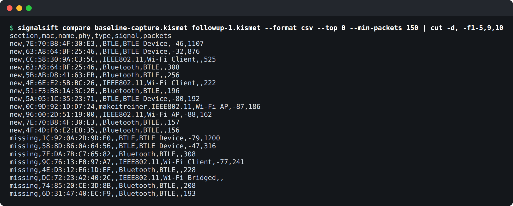

```bash
signalsift compare baseline.kismet followup.kismet --format csv > devices.csv
```

## HTML reports

Reports are a single file with no scripts or external assets, so they can be emailed, archived or opened offline.

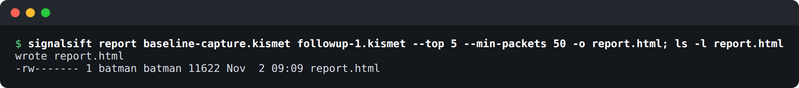

The file is created readable only by you, because it describes the devices at a surveyed location. Use `--html` on `compare` to get a report and terminal output from the same run:

```bash
signalsift compare baseline.kismet followup.kismet --html report.html
```

Reports follow the viewer's light or dark system theme.

<table>
  <tr>
    <th>Light</th>
    <th>Dark</th>
  </tr>
  <tr>
    <td>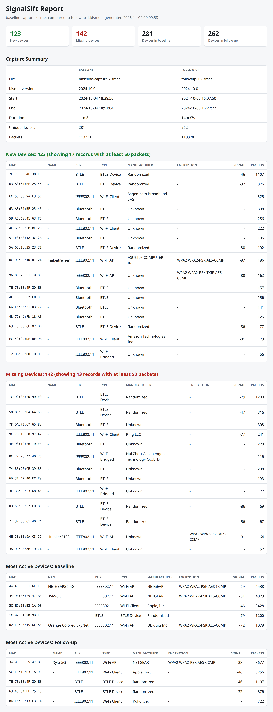</td>
    <td>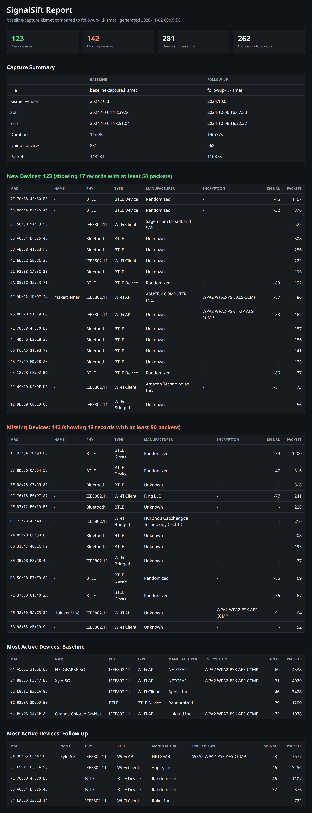</td>
  </tr>
</table>

## Scripting

JSON output works well with [`jq`](https://jqlang.github.io/jq/). For example, to list the new Wi-Fi networks by name:

```bash
signalsift compare baseline.kismet followup.kismet --format json \
  | jq -r '.new[] | select(.type == "Wi-Fi AP" and .name != "") | [.mac, .name, .packets] | @tsv'
```

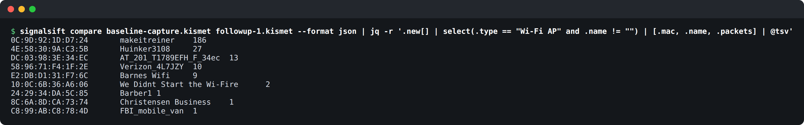

`jq -e` turns a check into an exit code, which suits scheduled jobs:

```bash
signalsift compare baseline.kismet nightly.kismet --format json \
  | jq -e '.new_total == 0' > /dev/null || notify-send "New wireless devices detected"
```

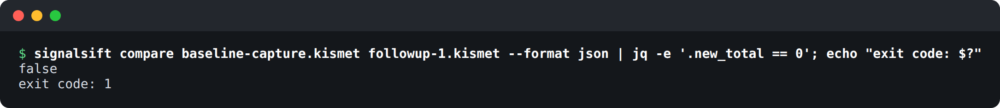

SignalSift exits with `0` on success and `1` on any error. Differences between captures are not errors, so the exit code alone won't tell you whether anything changed.

## How results are calculated

| Value | How it works |
| --- | --- |
| **New / missing** | Devices are matched by MAC address alone. A device picked up by a different radio, such as `Bluetooth` in one capture and `BTLE` in the other, is not reported as a change. |
| **Totals** | New and missing totals count distinct MACs. A MAC seen on several PHYs gets one row per PHY, so a heading may read `123 (126 records across PHYs)`. |
| **Packets** | The higher of Kismet's own total for the device and the number of rows in the `packets` table for that MAC and PHY. Neither source is complete alone: Bluetooth devices have no rows in the `packets` table, and the device total can lag behind it. |
| **Signal** | The strongest signal in dBm. Kismet stores `0` when it never measured one, so SignalSift shows `-` in tables and `null` in JSON. |
| **Name** | Kismet's common name, which is the SSID for access points. It is blank when Kismet only knows the MAC. |
| **Sorting** | Busiest first, then by MAC and PHY, so identical inputs always give identical output. |

The capture summary's packet count includes every logged packet, even those with no source device, so it is much higher than the sum of the device counts.

## Reading the results

- **Randomized MACs inflate both lists.** Phones and BTLE devices rotate their addresses, so one device can appear as several new and missing entries. The `manufacturer` field reads `Randomized` for many of these.
- **A missing device isn't necessarily gone.** It may have been idle during the capture, so compare captures of similar length.
- **Use `--min-packets` with care in TSCM work.** It reduces noise, but a covert transmitter may be deliberately quiet. Review the unfiltered list before ruling anything out.
- **Names can be spoofed.** Anyone can broadcast any SSID, so treat a name as a claim rather than an identity.

## Security

- **Your captures are not modified.** Files are opened read-only, and finished captures create no journal or lock files, so read-only media and write-blocked evidence drives work. To check this yourself, compare checksums before and after a run:

  ```bash
  md5sum *.kismet
  signalsift compare baseline.kismet followup.kismet > /dev/null
  md5sum *.kismet
  ```

- **Nothing leaves your machine.** SignalSift makes no network connections and opens no ports.
- **Over-the-air names are treated as hostile.** SSIDs and Bluetooth names are controlled by whoever is transmitting, so:
  - Control characters and bidirectional overrides are shown as visible escapes such as `\u001b`, which stops a crafted name from sending commands to your terminal or disguising itself.
  - CSV cells that a spreadsheet would run as a formula are prefixed with `'`.
  - HTML reports escape all names and contain no scripts.
- **Captures reveal locations.** `*.kismet` files and `report.html` are ignored by git in this repository, and the file permissions on reports are private. Take the same care wherever you store them.

## Common issues

### Permission denied

Kismet often runs as root, which leaves captures that your user can't read:

```
error: cannot read capture: open capture.kismet: permission denied
```

Change the owner of the file to your user:

```bash
sudo chown "$USER":"$USER" capture.kismet
```

For a whole directory:

```bash
sudo chown -R "$USER":"$USER" /path/to/captures
```

### "is not a Kismet database"

SignalSift only reads Kismet's SQLite logs, and this error means the file is something else.

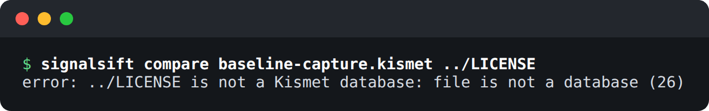

A common cause is copying captures to or from macOS, which leaves hidden `._capture.kismet` metadata files beside the real ones. These can be matched by wildcards such as `.*.kismet` and can safely be ignored.

### A capture shows "no packets"

The capture's `packets` table is empty, usually because Kismet stopped immediately or packet logging was turned off. SignalSift still compares its devices.

### Comparing a capture that is still running

SignalSift detects Kismet's journal file and reads the capture through SQLite's normal locking, but the results only reflect what has been written so far. Stop Kismet first for a complete comparison.

## Development

```
cmd/signalsift/     Command-line interface (cobra)
internal/kismet/    Reads and sanitises .kismet databases
internal/compare/   Diffs two captures into a report
internal/render/    Table, JSON, CSV and HTML output
```

```bash
go test ./...
go vet ./...
go build -ldflags "-X main.version=1.0.0" -o signalsift ./cmd/signalsift
```

Contributions are welcome. Please feel free to submit a pull request.

## License

This project is licensed under the MIT License. See the [LICENSE](./LICENSE) file for details.

## Acknowledgments

[Kismet Wireless](https://www.kismetwireless.net/), for their excellent wireless network detector and sniffer.
